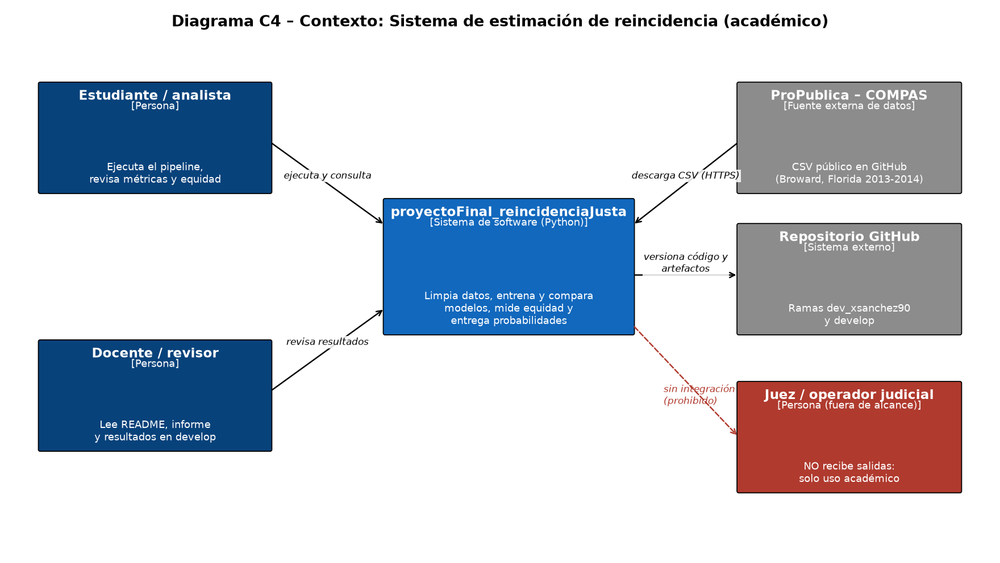
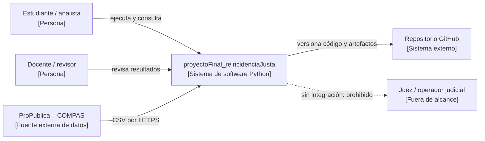
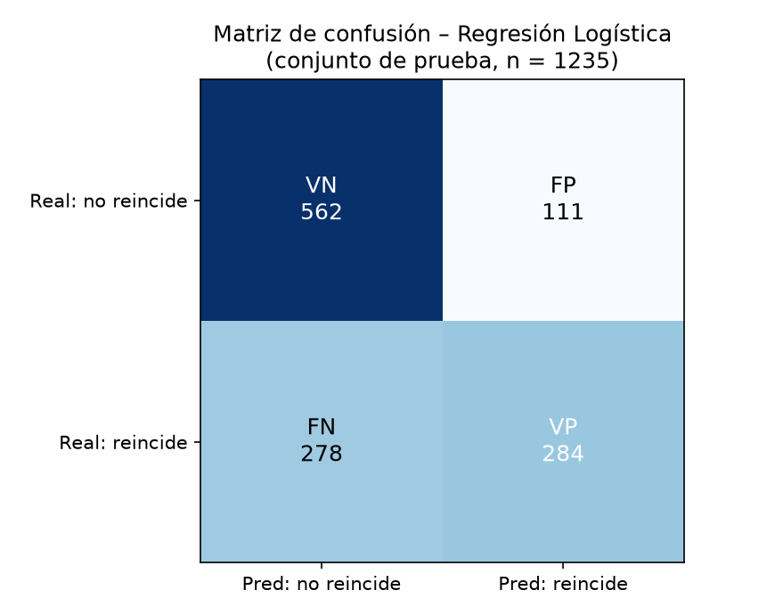
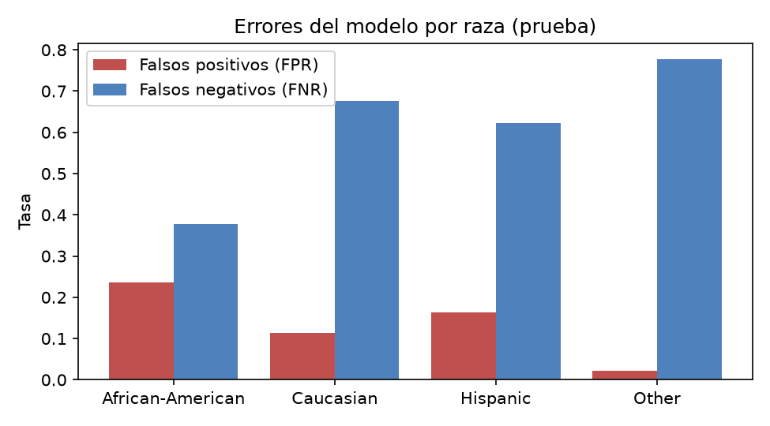

# proyectoFinal_reincidenciaJusta

**Mini-proyecto de Machine Learning: predicción de reincidencia penal con Regresión Logística, evaluación de desempeño y análisis ético.**

- **Autora:** Ximena Sánchez Martínez
- **Asignatura:** Teoría de la Computación II, Universidad de La Salle
- **Actividad:** Actividad 6. Mini-proyecto
- **Rama de trabajo:** `dev_xsanchez90`, consolidada en `develop`
- **Informe completo (PDF):** [`docs/informe_mini_proyecto.pdf`](docs/informe_mini_proyecto.pdf)

---

## 1. Qué problema se resuelve

En varios sistemas judiciales se usan algoritmos para estimar si una persona acusada volverá a delinquir. Ese puntaje influye en decisiones sobre libertad provisional, fianza o condena. El caso más conocido es **COMPAS**, una herramienta comercial usada en Estados Unidos. En 2016 la organización periodística ProPublica publicó los datos del condado de Broward (Florida) y mostró que la herramienta se equivocaba de forma distinta según la raza de la persona.

Este proyecto **construye un modelo propio, sencillo y transparente** que estima la probabilidad de que una persona reincida en los dos años siguientes. Después mide qué tan bien funciona y, sobre todo, **a quién perjudican sus errores**. La pregunta central es:

> ¿Puede un modelo básico de Machine Learning predecir la reincidencia con un desempeño comparable al de COMPAS, y es justo con todos los grupos de la población?

## 2. Con qué datos

| Elemento | Detalle |
|---|---|
| Fuente | ProPublica, *compas-analysis* (GitHub), archivo `compas-scores-two-years.csv` |
| Población | Personas evaluadas con COMPAS en Broward County, Florida, entre 2013 y 2014 |
| Registros | 7.214 originales; **6.172** después de los filtros de ProPublica |
| Objetivo (`two_year_recid`) | 1 = volvió a ser acusada de un delito en dos años; 0 = no. Tasa de reincidencia: 45,5 % |
| Variables del modelo | `age` (edad), `priors_count` (antecedentes de adulto), `juv_fel_count`, `juv_misd_count`, `juv_other_count` (antecedentes juveniles por tipo), `c_charge_degree` (F = delito grave, M = delito menor) |
| Variables solo para auditar | `race` (raza) y `sex` (sexo). **No entran al modelo**; se usan para medir la equidad |
| Punto de comparación | `decile_score`: el puntaje COMPAS (1 a 10). Decil ≥ 5 = riesgo medio o alto |

Filtros aplicados (los mismos de ProPublica): arresto a menos de 30 días de la evaluación, caso con desenlace conocido, delitos ordinarios (F o M) y puntaje válido.

**Privacidad:** el CSV original trae nombres, fechas de nacimiento y números de caso. Ese archivo **no se sube al repositorio** (`.gitignore`). El código lo descarga y guarda solo las 10 columnas necesarias en `data/compas_limpio.csv`.

Composición del dataset limpio: 3.175 afroamericanos, 2.103 caucásicos, 509 hispanos, 343 «otros», 31 asiáticos y 11 nativos americanos; 4.997 hombres y 1.175 mujeres.

## 3. Cómo funciona la solución

El proyecto sigue las siete etapas del workflow básico de Machine Learning:

| Etapa | Dónde está | Qué se hace |
|---|---|---|
| 1. Definir la tarea | Este README, sección 1 | Clasificación binaria: reincide / no reincide |
| 2. Recolectar datos | `src/datos.py` → `descargar()` | Descarga el CSV público de ProPublica |
| 3. Representar la entrada | `src/datos.py` → `limpiar()`, `src/modelos.py` → `preprocesador()` | Filtros, quita datos personales, estandariza números y codifica el grado del cargo |
| 4. Elegir modelo | `src/modelos.py` | Referencia, Regresión Logística, Árbol de Decisión y KNN |
| 5. Entrenar | `src/entrenar_evaluar.py` | Validación cruzada de 5 particiones sobre el 80 % de entrenamiento |
| 6. Evaluar | `src/entrenar_evaluar.py` | Métricas en el 20 % de prueba, matriz de confusión y auditoría de equidad |
| 7. Usar con datos nuevos | `src/predecir.py` | Probabilidad para un caso nuevo, con validación de entradas |

```
proyectoFinal_reincidenciaJusta/
├── data/                 compas_limpio.csv (sin datos personales)
├── docs/                 C4, informe PDF y scripts que los generan
├── resultados/           métricas, tablas de equidad, gráficas y modelo.joblib
├── src/                  config, datos, modelos, entrenar_evaluar, predecir
├── tests/                pruebas de datos y criterios de aceptación
└── requirements.txt
```

### Cómo reproducirlo

```bash
pip install -r requirements.txt
python -m src.entrenar_evaluar          # descarga, entrena, evalúa y guarda resultados
python -m pytest -q                     # 9 pruebas de datos y aceptación
python -m src.predecir --edad 23 --antecedentes 4 --grado F
python docs/generar_c4.py               # diagrama C4
python docs/generar_informe.py          # informe PDF
```

## 4. Alcance: qué hace y qué no hace el sistema

**Sí hace:**
- Descarga y limpia el dataset público, y elimina los datos personales.
- Entrena y compara cuatro modelos con la misma separación de datos.
- Calcula accuracy, precision, recall, F1, AUC y la matriz de confusión.
- Mide las tasas de error por raza y por sexo, y las compara con las de COMPAS.
- Estima la probabilidad de reincidencia de un caso nuevo desde la línea de comandos.

**No hace:**
- No toma decisiones judiciales ni debe usarse con personas reales. Es un ejercicio académico.
- No usa la raza ni el sexo como variables de entrada.
- No tiene interfaz web, API ni base de datos. Tampoco se despliega en la nube.
- No corrige el sesgo de los datos de origen: lo mide y lo hace visible.
- No sirve para otros países o épocas: los datos son de un solo condado de EE. UU. (2013-2014).

## 5. Diagrama C4 de contexto





## 6. Decisiones de arquitectura (ADR)

### ADR-001. Enfoque de implementación: scripts de Python por lotes con scikit-learn
- **Contexto:** el proyecto debe ser reproducible por el docente y evidenciar cada etapa del workflow.
- **Decisión:** módulos de Python (`src/`) ejecutados desde la terminal, con `Pipeline` de scikit-learn y una semilla fija (42).
- **Alternativas:** notebooks de Jupyter (fáciles de leer, pero dependen del orden de ejecución de las celdas) o un servicio web (innecesario para el alcance).
- **Consecuencias:** un solo comando regenera todos los resultados. El preprocesamiento vive dentro del `Pipeline`, así que nunca se ajusta con datos de prueba.

### ADR-002. Selección de modelo: Regresión Logística
- **Contexto:** se compararon cuatro modelos con validación cruzada. En F1 quedaron prácticamente empatados (0,597 a 0,604, con desviaciones de ±0,03).
- **Decisión:** usar Regresión Logística.
- **Razones:** tiene el mejor AUC en validación cruzada (0,726); cada coeficiente se puede explicar («más antecedentes, más riesgo»); da probabilidades, no solo un sí o un no. En un contexto judicial, la **transparencia pesa más** que una diferencia de 0,01 en F1.
- **Consecuencias:** en la prueba, el Árbol de Decisión tuvo un F1 algo mayor (0,629 frente a 0,594). Se acepta ese costo a cambio de la interpretabilidad, y se documenta.

### ADR-003. Almacenamiento y despliegue: archivos locales versionados en Git, sin despliegue
- **Contexto:** el dataset es pequeño (≈ 1 MB) y el modelo no debe usarse en producción por razones éticas.
- **Decisión:** guardar en el repositorio los datos limpios (sin datos personales), las métricas (`metricas.json`, CSV), las gráficas y el modelo (`modelo.joblib`). El CSV original no se versiona.
- **Alternativas:** base de datos o almacenamiento en la nube (S3), o desplegar una API. Se descartaron por costo y porque **desplegar un modelo de riesgo penal sería un uso irresponsable**.
- **Consecuencias:** cualquiera puede revisar los resultados sin ejecutar nada. El modelo solo se usa localmente con `src/predecir.py`.

### ADR-004. Equidad por omisión de variables sensibles, con auditoría
- **Decisión:** no usar raza ni sexo como entradas, pero conservarlas para medir los errores por grupo.
- **Consecuencia:** quitar la variable **no basta**. Los antecedentes reflejan patrones de detención desiguales y funcionan como variable sustituta (*proxy*). La auditoría lo muestra (sección 7.4).

## 7. Calidad y evaluación del modelo

### 7.1 Estrategia de separación de datos
- 80 % entrenamiento (4.937) y 20 % prueba (1.235), **estratificado** por la variable objetivo y con semilla 42.
- La comparación de modelos se hizo con **validación cruzada estratificada de 5 particiones** solo dentro del entrenamiento.
- La prueba se usó **una sola vez**, al final. El escalado y la codificación se ajustan dentro del `Pipeline`, así que no hay fuga de información. Lo verifica `test_sin_fuga_entre_train_y_test`.

### 7.2 Comparación con validación cruzada (entrenamiento)

| Modelo | Accuracy | Precision | Recall | F1 | AUC |
|---|---|---|---|---|---|
| Referencia (clase mayoritaria) | 0,545 | 0,000 | 0,000 | 0,000 | 0,500 |
| **Regresión Logística** | **0,673** | **0,680** | 0,532 | 0,597 | **0,726** |
| Árbol de Decisión (prof. 4) | 0,671 | 0,671 | 0,544 | 0,600 | 0,717 |
| KNN (k = 15) | 0,652 | 0,627 | 0,583 | 0,604 | 0,700 |

### 7.3 Resultados en el conjunto de prueba

| Modelo | Accuracy | Precision | Recall | F1 | AUC |
|---|---|---|---|---|---|
| Referencia (clase mayoritaria) | 0,545 | 0,000 | 0,000 | 0,000 | 0,500 |
| **Regresión Logística (elegido)** | **0,685** | **0,719** | 0,505 | 0,594 | **0,731** |
| Árbol de Decisión | 0,687 | 0,684 | 0,582 | 0,629 | 0,728 |
| KNN (k = 15) | 0,675 | 0,662 | 0,585 | 0,621 | 0,707 |
| COMPAS real (decil ≥ 5) | 0,663 | 0,637 | 0,605 | 0,620 | 0,716 |

**Interpretación de las métricas (Regresión Logística):**
- **Accuracy 0,685:** acierta en 69 de cada 100 personas. La referencia, que dice siempre «no reincide», acierta en 55. El modelo aporta, pero falla en casi un tercio de los casos.
- **Precision 0,719:** de cada 100 personas que marca como de alto riesgo, 72 sí reincidieron y 28 no. Esas 28 serían tratadas con más dureza sin motivo.
- **Recall 0,505:** detecta solo la mitad de quienes sí reincidieron. La otra mitad pasa como de bajo riesgo.
- **F1 0,594:** equilibra precision y recall. Queda bajo porque el recall es bajo.
- **AUC 0,731:** si se toma al azar una persona que reincidió y otra que no, el modelo le da más riesgo a la primera el 73 % de las veces. Es el mismo nivel que COMPAS (0,716), con solo 6 variables públicas.

### 7.4 Matriz de confusión (Regresión Logística, prueba)



| | Predicho: no reincide | Predicho: reincide |
|---|---|---|
| **Real: no reincide** | VN = 562 | FP = 111 |
| **Real: reincide** | FN = 278 | VP = 284 |

- **Verdaderos positivos (VP = 284):** personas que reincidieron y el modelo las marcó como de alto riesgo. Acierto.
- **Verdaderos negativos (VN = 562):** personas que no reincidieron y el modelo las marcó como de bajo riesgo. Acierto.
- **Falsos positivos (FP = 111):** personas que **no** reincidieron, pero el modelo las marcó como de alto riesgo. Es el error más grave en justicia: puede significar negar la libertad a alguien que no lo merecía.
- **Falsos negativos (FN = 278):** personas que **sí** reincidieron, pero el modelo las dejó como de bajo riesgo. Afecta la seguridad de las víctimas potenciales.

### 7.5 Auditoría de equidad

| Grupo (prueba) | n | Reincidencia real | Marcados alto riesgo | FPR | FNR |
|---|---|---|---|---|---|
| Afroamericano | 641 | 52,6 % | 44,0 % | **0,237** | 0,377 |
| Caucásico | 427 | 37,7 % | 19,2 % | **0,113** | 0,677 |
| Hispano | 94 | 47,9 % | 26,6 % | 0,163 | 0,622 |
| Hombres | 1.002 | 47,6 % | 34,9 % | 0,192 | 0,478 |
| Mujeres | 233 | 36,5 % | 19,3 % | 0,068 | 0,588 |

- Aunque el modelo **no conoce la raza**, una persona afroamericana que no reincide tiene el **doble de probabilidad** de ser marcada como de alto riesgo que una caucásica (FPR 0,237 frente a 0,113). Con las personas caucásicas pasa lo contrario: el modelo deja escapar al 68 % de quienes sí reincidieron.
- COMPAS tiene la misma brecha, pero más grande: FPR de 0,401 frente a 0,207 (diferencia de 0,19). Nuestro modelo la reduce a 0,12, pero **no la elimina**.



### 7.6 Criterios de aceptación del software

| Criterio | Umbral | Resultado | ¿Cumple? |
|---|---|---|---|
| Supera a la referencia en F1 | F1 > 0 | 0,594 | Sí |
| F1 mínimo | ≥ 0,55 | 0,594 | Sí |
| AUC mínimo | ≥ 0,70 | 0,731 | Sí |
| Brecha de FPR afro vs. caucásico | ≤ 0,10 | 0,124 | **No** |
| Sin datos personales en el repo | — | Verificado por prueba | Sí |
| Sin fuga train/test | — | Verificado por prueba | Sí |
| Rechaza entradas inválidas | — | Verificado por prueba | Sí |

**Veredicto:** el modelo es **técnicamente aceptable como ejercicio académico**, pero **no es apto para decisiones reales**, porque no cumple el criterio de equidad.

## 8. Riesgos técnicos

| # | Riesgo | Impacto | Mitigación |
|---|---|---|---|
| 1 | **Sesgo en los datos** (registros de arrestos desiguales por raza; los antecedentes funcionan como *proxy*) | Alto: errores más dañinos para un grupo | Se excluyen raza y sexo de las entradas, se audita FPR/FNR por grupo y se fija un criterio de equidad. Se declara que no es apto para uso real |
| 2 | **Fuga de información entre conjuntos** | Medio: métricas infladas | `Pipeline` que ajusta el preprocesamiento solo con entrenamiento, separación estratificada única y prueba automática de índices disjuntos |
| 3 | **Sobreajuste** | Medio: buen desempeño en entrenamiento, malo con casos nuevos | Modelos simples (árbol con profundidad 4, KNN con k = 15), validación cruzada de 5 particiones y comparación CV frente a prueba (diferencias < 0,02 en AUC) |
| 4 | **Datos insuficientes o poco representativos** (31 asiáticos y 11 nativos americanos; un solo condado) | Medio: no se puede medir la equidad para todos | Los grupos con menos de 50 casos no se reportan; se documenta que el modelo no se puede generalizar |
| 5 | **Etiqueta imperfecta**: «reincidir» significa «volver a ser acusado», no «volver a delinquir» | Alto: el modelo aprende patrones de vigilancia policial | Se documenta como limitación; se recomienda usar condenas o datos de otras fuentes |

## 9. Glosario

| Término | Definición |
|---|---|
| **Accuracy** | Proporción de predicciones correctas sobre el total |
| **AUC (ROC)** | Probabilidad de que el modelo asigne más riesgo a un caso positivo que a uno negativo elegido al azar. 0,5 = azar; 1 = perfecto |
| **Clase positiva** | En este proyecto, «reincide» (`two_year_recid = 1`) |
| **COMPAS** | *Correctional Offender Management Profiling for Alternative Sanctions*: herramienta comercial de evaluación de riesgo penal |
| **Equidad (fairness)** | Que los errores del modelo no se concentren de forma injusta en un grupo |
| **Estratificación** | Separar los datos manteniendo la misma proporción de cada clase |
| **F1-Score** | Media armónica entre precision y recall |
| **FPR (tasa de falsos positivos)** | De las personas que no reincidieron, cuántas fueron marcadas como de alto riesgo |
| **FNR (tasa de falsos negativos)** | De las personas que sí reincidieron, cuántas fueron marcadas como de bajo riesgo |
| **Fuga de información (data leakage)** | Cuando información del conjunto de prueba se filtra al entrenamiento e infla las métricas |
| **Matriz de confusión** | Tabla que cruza la clase real con la predicha (VP, FP, VN, FN) |
| **Modelo de referencia (baseline)** | Modelo trivial que siempre predice la clase más frecuente; sirve para saber si el modelo real aporta algo |
| **Precision** | De los casos que el modelo marca como positivos, cuántos lo son de verdad |
| **Proxy** | Variable que, sin ser sensible, está correlacionada con una que sí lo es (aquí, los antecedentes con la raza) |
| **Recall (sensibilidad)** | De los casos positivos reales, cuántos detecta el modelo |
| **Regresión Logística** | Modelo lineal que estima la probabilidad de una clase con la función sigmoide |
| **Sobreajuste (overfitting)** | Cuando el modelo memoriza el entrenamiento y falla con datos nuevos |
| **Validación cruzada** | Dividir el entrenamiento en *k* partes y entrenar/evaluar *k* veces para estimar el desempeño |

## 10. Referencias

- Angwin, J., Larson, J., Mattu, S. y Kirchner, L. (2016). *Machine Bias*. ProPublica. https://www.propublica.org/article/machine-bias-risk-assessments-in-criminal-sentencing
- Larson, J., Mattu, S., Kirchner, L. y Angwin, J. (2016). *How We Analyzed the COMPAS Recidivism Algorithm*. ProPublica. https://www.propublica.org/article/how-we-analyzed-the-compas-recidivism-algorithm
- ProPublica. (2016). *compas-analysis* [Repositorio de datos]. GitHub. https://github.com/propublica/compas-analysis
- Chouldechova, A. (2017). Fair prediction with disparate impact: A study of bias in recidivism prediction instruments. *Big Data, 5*(2), 153-163. https://doi.org/10.1089/big.2016.0047
- Kleinberg, J., Mullainathan, S. y Raghavan, M. (2017). Inherent trade-offs in the fair determination of risk scores. *ITCS 2017*. https://arxiv.org/abs/1609.05807
- Dressel, J. y Farid, H. (2018). The accuracy, fairness, and limits of predicting recidivism. *Science Advances, 4*(1). https://doi.org/10.1126/sciadv.aao5580
- Pedregosa, F. et al. (2011). Scikit-learn: Machine Learning in Python. *Journal of Machine Learning Research, 12*, 2825-2830.
- Nygard, M. (2011). *Documenting Architecture Decisions*. https://cognitect.com/blog/2011/11/15/documenting-architecture-decisions
- Brown, S. *The C4 model for visualising software architecture*. https://c4model.com
- Ley 1581 de 2012 (Colombia). Régimen general de protección de datos personales.
